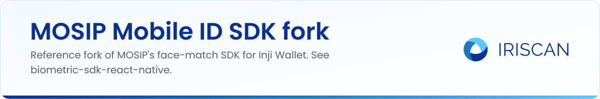

# mosip-mobileid-sdk (fork)

A fork of [mosip/mosip-mobileid-sdk](https://github.com/mosip/mosip-mobileid-sdk), kept for reference. MOSIP is an open-source platform for building national digital ID systems; Inji Wallet is its mobile wallet, and the Mobile ID SDK is the React Native face-matching component Inji calls to compare a selfie with the photo inside a credential.

Iriscan used this fork while building the face match that Inji ships today. The `main` branch holds only the upstream placeholder README; the upstream code is on `develop`, and the `IriScanDev`, `IriScanLivenessDev` and `InjiFaceSdk` branches hold the integration work. The maintained result is a separate package, [biometric-sdk-react-native](https://github.com/biometric-technologies/biometric-sdk-react-native), which is what Inji uses now.

Read how the integration works at https://www.iriscan.com/mosip and https://docs.iriscan.net/mosip.

License: not yet specified in this fork (no LICENSE file on `main`); the upstream repository is MIT-licensed.
